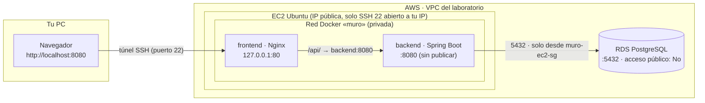

# T03 · Docker: del IDE al laboratorio

Tercera parte del bloque Docker. En **T01** viste los fundamentos (imágenes, contenedores, volúmenes, redes) y en **T02** cómo operar y diagnosticar fallos. Aquí juntas todo: partes de un programa que **ya funciona en tu IDE**, escribes tú los ficheros de contenedores entendiendo cada decisión, lo subes a GitHub y lo despliegas en AWS.

> El objetivo es el **despliegue**, no la programación. No tienes que tocar el código Java ni la web.

Cada paso tiene tres partes:

- **Por qué**: la idea que hay detrás.
- **Qué hacer**: las instrucciones.
- **Hecho cuando**: cómo sabes que puedes pasar al siguiente.

## Índice

0. [Qué vas a conseguir](#0-qué-vas-a-conseguir)
1. [Crear tu repositorio y ejecutar el programa en el PC](#1-crear-tu-repositorio-y-ejecutar-el-programa-en-el-pc)
2. [Decisiones de arquitectura](#2-decisiones-de-arquitectura)
3. [Backend: `.dockerignore` y `Dockerfile`](#3-backend-dockerignore-y-dockerfile)
4. [Frontend: `Dockerfile`, `.dockerignore` y `nginx.conf`](#4-frontend-dockerfile-dockerignore-y-nginxconf)
5. [`docker-compose.yml` de desarrollo](#5-docker-composeyml-de-desarrollo)
6. [`docker-compose.lab.yml` para el laboratorio](#6-docker-composelabyml-para-el-laboratorio)
7. [Subir a GitHub](#7-subir-a-github)
8. [Preparar AWS: grupos de seguridad, RDS y EC2](#8-preparar-aws-grupos-de-seguridad-rds-y-ec2)
9. [Instalar Docker en la EC2](#9-instalar-docker-en-la-ec2)
10. [Desplegar](#10-desplegar)
11. [Acceder desde tu PC por túnel SSH](#11-acceder-desde-tu-pc-por-túnel-ssh)
12. [Demostrar que los datos están fuera del contenedor](#12-demostrar-que-los-datos-están-fuera-del-contenedor)
13. [Actualizar la aplicación](#13-actualizar-la-aplicación)
14. [Errores frecuentes](#14-errores-frecuentes)
15. [Retos](#15-retos)
16. [Limpieza y costes](#16-limpieza-y-costes)
17. [Evidencias de entrega](#17-evidencias-de-entrega)
- [Resumen de ficheros](#resumen-de-ficheros)
- [Soluciones de los retos](#soluciones-de-los-retos)

---

## 0. Qué vas a conseguir

Al terminar tendrás el **Muro de notas** (una pizarra de post-its compartida) funcionando en AWS:

- Dos contenedores en una instancia **EC2**: **Nginx** (sirve la web y hace de proxy) y **Spring Boot** (la API).
- La base de datos en **RDS PostgreSQL**, fuera de los contenedores y sin acceso público.
- Acceso desde tu navegador a través de un **túnel SSH**: la web no está abierta a Internet.

**Tiempo estimado:** unas 2 horas (alrededor de 1 hora en el laboratorio).

### Requisitos previos

- Cuenta de **GitHub** y **Git** instalado en tu PC.
- **Java 21** o superior en tu PC (para ejecutar el programa en el IDE).
- Un IDE: IntelliJ IDEA, VS Code o Eclipse/STS.
- Acceso al **laboratorio de AWS Academy**.
- Conocer los comandos básicos de Docker (T01 y T02).
- *Opcional:* Docker Desktop en tu PC (solo para el paso 5).

### El recorrido

```
  Tu PC (IDE)  ──git push──►  GitHub  ──git clone──►  EC2  ──docker compose──►  contenedores  ──►  RDS
  paso 1-6                    paso 7                   paso 8-9                  paso 10-13
```

### Arquitectura final



Qué es público y qué es privado:

| Elemento | ¿Accesible desde Internet? |
|----------|----------------------------|
| Puerto 22 (SSH) de la EC2 | Sí, **solo desde tu IP** (y desde EC2 Instance Connect) |
| Nginx (frontend) | **No**: escucha en `127.0.0.1:80` de la EC2; se llega por el túnel |
| Spring Boot (backend) | **No**: no publica ningún puerto; solo lo ve Nginx dentro de la red Docker |
| RDS | **No**: acceso público desactivado; solo admite conexiones desde la EC2 |

---

## 1. Crear tu repositorio y ejecutar el programa en el PC

### Por qué

Antes de meter nada en un contenedor, tienes que saber que **el programa funciona**. Si algo falla después, sabrás que el problema está en los contenedores o en AWS, no en el código.

### Qué hacer

**1. Crea tu repositorio desde la plantilla.**

1. Entra en el repositorio plantilla que te ha pasado el profesor y pulsa **Use this template → Create a new repository**.
2. Ponle un nombre (por ejemplo, `muro-notas`).
3. Deja **DESMARCADA** la casilla **Include all branches**. Solo quieres la rama `main`: la rama `solucion` se queda en el repositorio del profesor.
4. Elige **Public**, así podrás clonarlo en la EC2 sin configurar credenciales.

**2. Clónalo en tu PC y ábrelo en el IDE.**

```bash
git clone https://github.com/<tu-usuario>/<tu-repo>.git
cd <tu-repo>
```

**3. Ejecuta el programa con el perfil `local`.** Este perfil usa una base de datos **H2 en memoria**: no necesitas PostgreSQL ni variables de entorno. Además, Spring sirve la web, así que lo ves todo en un solo puerto.

Windows (PowerShell). El argumento `-D` **va entre comillas**; si no, PowerShell lo trocea y Maven no lo entiende:

```powershell
cd backend
.\mvnw.cmd spring-boot:run "-Dspring-boot.run.profiles=local"
```

Linux / macOS:

```bash
cd backend
./mvnw spring-boot:run -Dspring-boot.run.profiles=local
```

Desde el IDE: crea una configuración de ejecución para `MuroNotasApplication` con la variable de entorno `SPRING_PROFILES_ACTIVE=local` (o el argumento de programa `--spring.profiles.active=local`). La carpeta de trabajo debe ser `backend` o la raíz del repositorio.

> **Tarda unos 45 segundos** la primera vez (Maven descarga dependencias). Cuando aparece una línea como `Started MuroNotasApplication in ... seconds`, la terminal se queda **"parada"**. No está colgada: el servidor está en marcha esperando peticiones. Para pararlo, `Ctrl+C`.

**4. Abre <http://localhost:8080>.** Crea un par de notas, dale a like y borra una. Abre también <http://localhost:8080/api/estado>.

### Hecho cuando

- La web carga y la franja de arriba está **verde**: `API: OK · BD: OK · contenedor: <nombre de tu PC>`.
- `/api/estado` devuelve algo como `{"api":"ok","bd":"ok","contenedor":"...","version":"1.0.0"}`.

Para el programa con `Ctrl+C` antes de seguir. Si no, el puerto 8080 seguirá ocupado.

---

## 2. Decisiones de arquitectura

### Por qué

Los ficheros que vas a escribir no son arbitrarios: cada línea responde a una decisión. Si entiendes estas cuatro, el resto sale solo.

**Un contenedor por proceso.** Nginx y Spring Boot van en contenedores distintos. Cada uno tiene su imagen, sus logs y su ciclo de vida: puedes reconstruir el backend sin tocar el frontend, ver los logs de uno sin mezclarlos con los del otro, o reiniciar uno si falla. Meter los dos en el mismo contenedor obligaría a gestionar dos procesos dentro, que es justo lo que Docker no hace bien.

**La base de datos fuera, en RDS.** Un contenedor es **efímero**: lo borras y se pierde lo que tenía dentro. En desarrollo resolvemos eso con un volumen. En el lab hay una opción mejor: **RDS**, una base de datos gestionada por AWS, con copias de seguridad, actualizaciones y almacenamiento que no dependen de tu EC2. Si la instancia se rompe o la vuelves a crear, los datos siguen en RDS. Es lo habitual en producción: los contenedores no guardan estado; los datos viven en un servicio aparte.

**Nginx delante como proxy, y el backend sin puertos publicados.** El navegador solo habla con Nginx. Nginx sirve `index.html` y reenvía todo lo que empieza por `/api/` al backend por la red interna de Docker. Ventajas:

- **Un solo origen**: la web y la API están en la misma dirección, así que no hay problemas de CORS.
- **Menos superficie de ataque**: el backend no publica ningún puerto, así que nadie puede llegar a él saltándose Nginx.
- **Un punto de entrada**: si mañana añades HTTPS, se hace en Nginx sin tocar el backend.

**La configuración en variables de entorno.** La misma imagen del backend sirve para el PC y para el lab; lo único que cambia es a qué base de datos se conecta. Por eso `DB_HOST`, `DB_PASSWORD`, etc. llegan por variables de entorno, que Docker Compose lee de un fichero `.env`. Y el `.env` **no se sube nunca a Git**, porque contiene la contraseña.

### Qué hacer

Abre [`backend/src/main/resources/application.properties`](../backend/src/main/resources/application.properties) y localiza las líneas `spring.datasource.*`. Fíjate en la sintaxis `${DB_PORT:5432}`: variable `DB_PORT`, y si no existe, `5432`. `DB_HOST` y `DB_PASSWORD` no tienen valor por defecto: si faltan, la aplicación se niega a arrancar.

Abre también [`.env.example`](../.env.example): es la plantilla del `.env` que crearás en la EC2.

### Hecho cuando

Sabes explicar con tus palabras por qué hay dos contenedores y no uno, por qué la base de datos no va en un contenedor en el lab y por qué el backend no publica puertos.

---

## 3. Backend: `.dockerignore` y `Dockerfile`

### Por qué

La imagen del backend tiene que **compilar** el proyecto y después **ejecutarlo**. Para compilar hacen falta Maven y un JDK (cientos de MB); para ejecutar basta con un JRE y el `.jar`. Con una **construcción en dos etapas** usamos una imagen grande para compilar y nos llevamos solo el `.jar` a una imagen pequeña.

### Qué hacer

**1. Crea `backend/.dockerignore`:**

```
# La imagen se compila con Maven dentro de Docker: solo hacen falta pom.xml y src/
target/
.mvn/
mvnw
mvnw.cmd
.env
.idea/
.vscode/
*.iml
```

El `.dockerignore` decide qué **no** se envía a Docker al construir (el *contexto de construcción*). Quitamos:

- `target/`: lo que hayas compilado en tu PC. Dentro de la imagen se compila de cero; si no lo excluyes, viajan megas inútiles y podrías colar un `.jar` viejo.
- `.mvn/`, `mvnw`, `mvnw.cmd`: el Maven Wrapper. La imagen de compilación ya trae Maven.
- `.env`: **nunca** debe acabar dentro de una imagen; cualquiera que tenga la imagen podría leer la contraseña.
- Ficheros del IDE: no pintan nada en la imagen.

**2. Crea `backend/Dockerfile`:**

```dockerfile
# ===== Etapa 1: compilar =====
# Imagen con Maven y JDK 21: trae todo lo necesario para compilar, pero pesa mucho
FROM maven:3.9-eclipse-temurin-21 AS compilacion
WORKDIR /app

# Primero solo el pom.xml: si no cambian las dependencias, Docker reutiliza esta capa de la caché
COPY pom.xml .
RUN mvn -B -q dependency:go-offline

# Después el código: es lo que cambia a menudo, así solo se repite desde aquí
COPY src ./src
# Los tests se pasan fuera (mvnw test); aquí solo empaquetamos el .jar
RUN mvn -B -q package -DskipTests

# ===== Etapa 2: ejecutar =====
# Solo JRE 21 sobre Alpine: lo justo para ejecutar el .jar, la imagen final es mucho más ligera
FROM eclipse-temurin:21-jre-alpine
WORKDIR /app

# Usuario sin privilegios: si alguien compromete la app, no es root dentro del contenedor
RUN addgroup -S muro && adduser -S muro -G muro

# De la etapa 1 solo nos llevamos el .jar; Maven y el código fuente se quedan fuera
COPY --from=compilacion /app/target/muro-notas.jar app.jar

USER muro

# Puerto de Spring Boot dentro del contenedor (documentativo; no se publica al exterior)
EXPOSE 8080

ENTRYPOINT ["java", "-jar", "app.jar"]
```

Explicado por bloques:

**Etapa 1: compilar.** `AS compilacion` le da nombre a la etapa para poder copiar de ella después. La imagen `maven:3.9-eclipse-temurin-21` trae Maven y el JDK 21.

**Caché de capas: primero el `pom.xml`, después el código.** Cada instrucción del Dockerfile crea una capa, y Docker reutiliza las capas que no han cambiado. Si copiases todo de golpe, cualquier cambio en una línea de Java invalidaría la caché y Maven volvería a descargar **todas** las dependencias (varios minutos). Separándolo:

1. `COPY pom.xml .` + `dependency:go-offline`: descarga las dependencias. Solo se repite si cambias el `pom.xml`.
2. `COPY src ./src` + `package`: compila tu código. Se repite cada vez que cambias el código, pero ya tiene las dependencias.

`-DskipTests`: los tests se ejecutan antes, en tu PC (`mvnw test`). Aquí solo empaquetamos. El nombre `muro-notas.jar` es fijo porque el `pom.xml` define `<finalName>muro-notas</finalName>`.

**Etapa 2: ejecutar.** Empieza una imagen **nueva** a partir de `eclipse-temurin:21-jre-alpine`. Todo lo de la etapa 1 (Maven, JDK, código fuente, caché de dependencias) **no** pasa a la imagen final; solo lo que copias con `COPY --from=compilacion`.

**¿Por qué JRE y no JDK?** El JDK incluye el compilador y herramientas de desarrollo que en ejecución no se usan. El JRE solo tiene lo necesario para ejecutar el `.jar`: la imagen pesa mucho menos, se descarga antes y tiene menos componentes que puedan tener vulnerabilidades. Alpine es una distribución Linux mínima que reduce aún más el tamaño.

**Usuario sin privilegios.** Por defecto, los procesos de un contenedor se ejecutan como `root`. `addgroup`/`adduser` crean un usuario `muro` y `USER muro` hace que Java se ejecute con él. Si alguien explota un fallo de la aplicación, no tendrá permisos de administrador dentro del contenedor.

**`EXPOSE 8080`** solo documenta en qué puerto escucha la aplicación. **No publica nada**: publicar es cosa de `ports:` en el compose, y el backend no lo usa.

**`ENTRYPOINT`** en forma de lista (`["java", "-jar", "app.jar"]`): Java es el proceso principal del contenedor y recibe directamente las señales de parada de Docker.

### Hecho cuando

Tienes `backend/.dockerignore` y `backend/Dockerfile` y sabes explicar por qué el `pom.xml` se copia antes que `src/` y qué hay (y qué no) en la imagen final.

---

## 4. Frontend: `Dockerfile`, `.dockerignore` y `nginx.conf`

### Por qué

La web es un único fichero estático (`index.html`). No hace falta compilar nada: basta un servidor web. Nginx sirve la web **y** hace de proxy hacia el backend, siguiendo las reglas de `nginx.conf`.

### Qué hacer

**1. Crea `frontend/Dockerfile`:**

```dockerfile
# Nginx en Alpine: un servidor web pequeño y rápido para servir un HTML estático
FROM nginx:alpine

# Nuestra configuración: sirve la web y reenvía /api/ al backend
COPY nginx.conf /etc/nginx/conf.d/default.conf

# La web completa es un solo fichero
COPY index.html /usr/share/nginx/html/index.html

# Puerto en el que escucha Nginx dentro del contenedor (documentativo)
EXPOSE 80
```

No hay `CMD` ni `ENTRYPOINT`: los hereda de la imagen `nginx:alpine`, que ya arranca Nginx. Nuestro `nginx.conf` **sustituye** la configuración por defecto (`default.conf`).

**2. Crea `frontend/.dockerignore`:**

```
# Solo necesitamos index.html y nginx.conf; el resto no entra en la imagen
*
!index.html
!nginx.conf
```

Aquí se usa la estrategia contraria al backend: **excluir todo** (`*`) y permitir solo lo necesario (`!`). Es la opción más segura cuando sabes exactamente qué ficheros hacen falta.

**3. Lee `frontend/nginx.conf`** (ya está en el repositorio, no tienes que escribirlo):

```nginx
# Configuración del servidor web. Sustituye a /etc/nginx/conf.d/default.conf dentro de la imagen.
server {
    listen 80;
    server_name _;

    root /usr/share/nginx/html;
    index index.html;

    # La web: un único index.html
    location / {
        try_files $uri $uri/ /index.html;
    }

    # La API: todo lo que empieza por /api/ se reenvía al contenedor "backend".
    # "backend" es el nombre del servicio en docker-compose; Docker lo resuelve a su IP.
    location /api/ {
        proxy_pass http://backend:8080;
        proxy_set_header Host $host;
        proxy_set_header X-Real-IP $remote_addr;
        proxy_set_header X-Forwarded-For $proxy_add_x_forwarded_for;
    }
}
```

Cómo funciona el reenvío de `/api/`:

1. El navegador pide `http://localhost:8080/api/notas`. En `index.html` la API está definida como `const API = "/api"`, una ruta relativa: va al mismo servidor que sirvió la web.
2. Nginx ve que la ruta empieza por `/api/` y aplica `proxy_pass http://backend:8080`.
3. `backend` **no es un dominio de Internet**: es el **nombre del servicio** en el docker-compose. El DNS interno de Docker lo traduce a la IP del contenedor del backend en la red `muro`.
4. Como `proxy_pass` no lleva ruta detrás del puerto, la petición llega al backend tal cual: `http://backend:8080/api/notas`.
5. Las cabeceras `X-Real-IP` y `X-Forwarded-For` le dicen al backend la IP original del cliente (si no, vería siempre la de Nginx).

### Hecho cuando

Tienes `frontend/Dockerfile` y `frontend/.dockerignore`, y sabes explicar qué significa `backend` en `proxy_pass http://backend:8080`.

---

## 5. `docker-compose.yml` de desarrollo

> **[POR VERIFICAR EN LAB LIMPIO]** Todo este paso está sin probar en Docker Desktop. Si encuentras algún problema, avisa al profesor.
>
> **Es opcional** si no tienes Docker en tu PC: crea el fichero igualmente (forma parte de la entrega), pero puedes saltarte la prueba y pasar al paso 6.

### Por qué

En desarrollo quieres levantar **todo** el sistema en tu PC con un comando: la base de datos, el backend y el frontend, comunicándose igual que lo harán en el lab. Aquí la base de datos sí va en un contenedor (con un volumen para que los datos no se pierdan), porque en tu PC no hay RDS.

### Qué hacer

**1. Crea `docker-compose.yml` en la raíz del repositorio:**

```yaml
# DESARROLLO: todo en tu máquina, incluida la base de datos en un contenedor.
# Arranque:  cp .env.example .env   y después   docker compose up --build
# Web:       http://localhost:8080

services:

  postgres:
    # Versión fija para que todos tengamos la misma
    image: postgres:17-alpine
    environment:
      POSTGRES_DB: ${DB_NAME:-muronotas}
      POSTGRES_USER: ${DB_USER:-postgres}
      POSTGRES_PASSWORD: ${DB_PASSWORD:?Falta DB_PASSWORD en el fichero .env}
    volumes:
      # Los datos sobreviven aunque borres el contenedor
      - datos-postgres:/var/lib/postgresql/data
    healthcheck:
      # pg_isready viene incluido en la imagen de postgres
      test: ["CMD-SHELL", "pg_isready -U $${POSTGRES_USER} -d $${POSTGRES_DB}"]
      interval: 5s
      timeout: 5s
      retries: 10
    networks:
      - muro
    restart: unless-stopped
    # Sin "ports": la BD solo es accesible desde la red interna "muro"

  backend:
    build: ./backend
    environment:
      DB_HOST: postgres          # nombre del servicio de arriba
      DB_PORT: "5432"
      DB_NAME: ${DB_NAME:-muronotas}
      DB_USER: ${DB_USER:-postgres}
      DB_PASSWORD: ${DB_PASSWORD:?Falta DB_PASSWORD en el fichero .env}
      DB_SSLMODE: disable        # el postgres local no usa SSL
    depends_on:
      postgres:
        condition: service_healthy   # no arranca hasta que postgres responda
    # Sin healthcheck propio: haría falta curl/wget dentro de la imagen y no lo
    # necesitamos; el estado se ve en la web (/api/estado).
    networks:
      - muro
    restart: unless-stopped
    # Sin "ports": solo Nginx habla con el backend

  frontend:
    build: ./frontend
    ports:
      - "8080:80"                # único puerto publicado: localhost:8080 -> Nginx
    depends_on:
      - backend
    networks:
      - muro
    restart: unless-stopped

networks:
  muro:

volumes:
  datos-postgres:
```

Explicado por bloques:

**Servicios.** Tres: `postgres` (usa una imagen ya hecha, `image:`), y `backend` y `frontend` (se construyen con tus Dockerfile, `build:`). El nombre de cada servicio es también su **nombre en la red**: por eso el backend usa `DB_HOST: postgres` y Nginx usa `http://backend:8080`.

**Variables.** `${DB_NAME:-muronotas}` significa "valor de `DB_NAME` del `.env`, o `muronotas` si no está". `${DB_PASSWORD:?mensaje}` significa "si no hay valor, **no arranques** y muestra el mensaje". La contraseña no tiene valor por defecto a propósito. Fíjate en que el backend recibe `DB_HOST` y `DB_SSLMODE` fijos: en desarrollo siempre son `postgres` y `disable`, diga lo que diga el `.env`.

**Red.** `networks: muro` crea una red privada para los tres. Solo los contenedores de esa red pueden hablar entre sí por nombre.

**Volumen.** `datos-postgres` es un volumen con nombre montado en la carpeta donde PostgreSQL guarda sus datos. Si haces `docker compose down`, el contenedor se borra pero el volumen sigue; con `down -v` se borra también el volumen (y tus notas).

**Healthcheck y `depends_on`.** `depends_on` a secas solo espera a que el contenedor **arranque**, no a que esté **listo**. PostgreSQL tarda unos segundos en aceptar conexiones; si el backend arrancase antes, fallaría al conectar. Por eso `postgres` tiene un `healthcheck` con `pg_isready` (cada 5 s, hasta 10 intentos) y el backend espera con `condition: service_healthy`. El `$$` en `$${POSTGRES_USER}` evita que Compose sustituya la variable: así la sustituye la shell **dentro** del contenedor.

**Puerto publicado.** Solo el frontend publica un puerto: `"8080:80"` (puerto 8080 de tu PC → puerto 80 del contenedor). Ni `postgres` ni `backend` tienen `ports:`, así que desde tu PC no se puede llegar a ellos directamente.

**`restart: unless-stopped`.** Si un contenedor se cae, Docker lo vuelve a arrancar, salvo que lo hayas parado tú.

**2. Pruébalo (solo si tienes Docker Desktop).** Asegúrate de que el programa del paso 1 está parado (usa el mismo puerto 8080). Desde la raíz del repositorio:

```bash
cp .env.example .env          # en PowerShell: Copy-Item .env.example .env
docker compose up --build
```

Abre <http://localhost:8080>. Para pararlo: `Ctrl+C` y después `docker compose down`.

### Hecho cuando

- Tienes `docker-compose.yml` en la raíz.
- *(Si tienes Docker)* La web carga en <http://localhost:8080> con la franja verde y el campo `contenedor` muestra un identificador corto (el del contenedor), no el nombre de tu PC.

---

## 6. `docker-compose.lab.yml` para el laboratorio

### Por qué

En el lab la base de datos es RDS, así que el compose cambia. Usamos un fichero distinto para que el de desarrollo siga funcionando igual y para que quede claro qué se ejecuta en cada sitio.

### Qué hacer

**Crea `docker-compose.lab.yml` en la raíz del repositorio:**

```yaml
# LABORATORIO (AWS): la base de datos es RDS, así que aquí no hay postgres.
# Las variables se leen del fichero .env de la instancia EC2.
# Arranque:  docker compose -f docker-compose.lab.yml up -d --build

services:

  backend:
    build: ./backend
    environment:
      DB_HOST: ${DB_HOST:?Falta DB_HOST (endpoint de RDS) en el fichero .env}
      DB_PORT: ${DB_PORT:-5432}
      DB_NAME: ${DB_NAME:-muronotas}
      DB_USER: ${DB_USER:-postgres}
      DB_PASSWORD: ${DB_PASSWORD:?Falta DB_PASSWORD en el fichero .env}
      DB_SSLMODE: ${DB_SSLMODE:-require}   # RDS admite SSL: lo pedimos
    # Sin healthcheck: ver el comentario en docker-compose.yml
    networks:
      - muro
    restart: unless-stopped

  frontend:
    build: ./frontend
    ports:
      # Solo en 127.0.0.1: desde fuera no se ve; se entra por túnel SSH
      - "127.0.0.1:80:80"
    depends_on:
      - backend
    networks:
      - muro
    restart: unless-stopped

networks:
  muro:
```

Qué cambia respecto al de desarrollo y por qué:

| Cambio | Por qué |
|--------|---------|
| **No hay servicio `postgres`** ni volumen `datos-postgres` | La base de datos es RDS. Los datos viven fuera de la EC2. |
| El backend no tiene `depends_on` | No hay ningún contenedor de base de datos al que esperar. |
| `DB_HOST` sale del `.env` y es **obligatoria** (`:?`) | Es el endpoint de RDS, distinto para cada alumno. Si se te olvida, Compose se niega a arrancar con un mensaje claro. |
| `DB_SSLMODE` por defecto `require` | La conexión con RDS sale de la EC2 por la red de AWS: la ciframos. |
| Puerto `"127.0.0.1:80:80"` en vez de `"8080:80"` | Nginx solo escucha en la interfaz local de la EC2. Aunque alguien abriese el puerto 80 en el grupo de seguridad, no llegaría. Se entra por túnel SSH (paso 11). |

### Hecho cuando

Tienes `docker-compose.lab.yml` en la raíz y sabes explicar por qué el puerto empieza por `127.0.0.1`.

---

## 7. Subir a GitHub

### Por qué

La EC2 va a clonar tu repositorio. Lo que no esté en GitHub no existirá en el lab. Y lo que **no** debe estar en GitHub (el `.env`) no debe subirse nunca.

### Qué hacer

Desde la raíz del repositorio:

```bash
git status
```

Deberías ver tus seis ficheros nuevos y **ningún `.env`**. Si creaste un `.env` en el paso 5, comprueba que Git lo ignora:

```bash
git check-ignore -v .env
```

Tiene que responder con una línea de `.gitignore`. Si no responde nada, **para** y revisa el `.gitignore` antes de seguir.

```bash
git add backend/Dockerfile backend/.dockerignore frontend/Dockerfile frontend/.dockerignore docker-compose.yml docker-compose.lab.yml
git commit -m "Añade los ficheros de Docker para desarrollo y laboratorio"
git push
```

> Si `git push` **se queda parado sin mostrar nada**, no está colgado: está esperando a que inicies sesión en GitHub en una ventana del navegador o del gestor de credenciales, que puede haberse abierto detrás de otras ventanas. Búscala en la barra de tareas.

### Hecho cuando

En la web de GitHub, en tu repositorio, ves los seis ficheros y **no** aparece ningún `.env`.

---

## 8. Preparar AWS: grupos de seguridad, RDS y EC2

### Por qué

Necesitas una máquina donde ejecutar los contenedores (EC2), una base de datos (RDS) y unas reglas de cortafuegos (grupos de seguridad) que dejen pasar solo el tráfico imprescindible. Los grupos se crean primero porque RDS y EC2 los necesitan al crearse.

### Qué hacer

Inicia el laboratorio de AWS Academy y abre la consola. Trabaja en la región **us-east-1 (Norte de Virginia)**.

#### 8.1 Grupos de seguridad

En **EC2 → Grupos de seguridad → Crear grupo de seguridad**, en la VPC predeterminada.

> AWS **no permite** nombres que empiecen por `sg-` (está reservado para los identificadores). Por eso los llamamos `muro-ec2-sg` y `muro-rds-sg`.

**`muro-ec2-sg`** (para la EC2). Reglas de entrada:

| Tipo | Puerto | Origen | Para qué |
|------|--------|--------|----------|
| SSH | 22 | **Mi IP** | Tu túnel SSH desde el PC |
| SSH | 22 | Lista de prefijos `com.amazonaws.us-east-1.ec2-instance-connect` | Que funcione el botón **Conectar** de la consola (EC2 Instance Connect) |

No abras el puerto 80 ni el 8080: a la web se entra por el túnel.

**`muro-rds-sg`** (para RDS). Regla de entrada:

| Tipo | Puerto | Origen | Para qué |
|------|--------|--------|----------|
| PostgreSQL | 5432 | Grupo de seguridad **`muro-ec2-sg`** | Solo las máquinas con ese grupo (tu EC2) pueden conectar a la base de datos |

Usar como origen **un grupo** y no una IP tiene una ventaja: aunque la IP de la EC2 cambie, la regla sigue valiendo.

#### 8.2 Base de datos RDS

En **RDS → Crear base de datos**:

| Opción | Valor |
|--------|-------|
| Método de creación | Creación estándar |
| Motor | PostgreSQL |
| Plantilla | **Capa gratuita** o **Desarrollo/pruebas** |
| Multi-AZ | Desactivado. *Si no aparece la opción, no hay que hacer nada.* |
| Identificador de la instancia | `muro-notas` |
| Nombre de usuario maestro | `postgres` |
| Contraseña maestra | Exactamente **`MuroNotas_Lab_2026!`**: es la clave de laboratorio común para toda la clase y ya viene en `.env.example` |
| Clase de instancia | `db.t3.micro` |
| Almacenamiento | 20 GB, **gp3** |
| Escalado automático del almacenamiento | **DESACTIVADO** |
| Copias de seguridad automáticas | Retención de 1 día |
| Conectividad / recurso de EC2 | No conectar a un recurso informático de EC2 |
| VPC | La predeterminada |
| Acceso público | **No** |
| Grupo de seguridad de VPC | Elegir existente: **`muro-rds-sg`** (quita `default`) |
| Configuración adicional → Nombre de base de datos inicial | **`muronotas`** |

Pulsa **Crear base de datos**. Tarda varios minutos en pasar a estado **Disponible**; mientras, crea la EC2.

Cuando esté disponible, entra en la base de datos y, en **Conectividad y seguridad**, copia el **Punto de enlace** (algo como `muro-notas.xxxxxxxx.us-east-1.rds.amazonaws.com`). Es tu `DB_HOST`.

#### 8.3 Instancia EC2

En **EC2 → Lanzar instancias**:

| Opción | Valor |
|--------|-------|
| Nombre | `muro-notas` |
| AMI | **Ubuntu Server 24.04 LTS** |
| Tipo de instancia | **t3.small**. Con 1 GB de memoria (t3.micro), la compilación de Spring dentro de Docker puede quedarse sin memoria. |
| Par de claves | **vockey** |
| Red | VPC predeterminada, con IP pública automática |
| Grupo de seguridad | Seleccionar existente: **`muro-ec2-sg`** |
| Almacenamiento | **20 GB** |

### Hecho cuando

- RDS está en estado **Disponible** y tienes apuntado su punto de enlace.
- La EC2 está **En ejecución** y tienes apuntada su **IP pública**.
- Desde la consola, **EC2 → tu instancia → Conectar → EC2 Instance Connect → Conectar** abre una terminal en la instancia.

---

## 9. Instalar Docker en la EC2

### Por qué

La AMI de Ubuntu viene limpia. Necesitas Docker, el plugin de Compose y Git para clonar tu repositorio.

### Qué hacer

Conéctate a la EC2 (botón **Conectar → EC2 Instance Connect**, o por SSH como en el paso 11) y ejecuta:

```bash
sudo apt-get update
sudo apt-get install -y docker.io docker-compose-v2 git
sudo usermod -aG docker $USER
```

La última línea añade tu usuario al grupo `docker` para no tener que escribir `sudo` delante de cada comando. **El cambio no se aplica a la sesión actual**: sal (`exit`) y vuelve a conectarte.

```bash
docker ps
docker compose version
```

### Hecho cuando

`docker ps` muestra la cabecera de la tabla (vacía) **sin `sudo`** y sin errores de permisos, y `docker compose version` muestra una versión.

---

## 10. Desplegar

### Por qué

Ahora juntas todo: tu código y tus ficheros desde GitHub, la configuración desde el `.env` y la base de datos en RDS.

### Qué hacer

En la EC2:

```bash
git clone https://github.com/<tu-usuario>/<tu-repo>.git
cd <tu-repo>
cp .env.example .env
nano .env
```

En `nano`, cambia `DB_HOST=` por el punto de enlace de RDS.

`DB_PASSWORD` ya trae `MuroNotas_Lab_2026!`, la misma contraseña que pusiste al crear RDS: no la cambies. Deja también `DB_NAME=muronotas`, `DB_USER=postgres` y `DB_SSLMODE=require`. Guarda con `Ctrl+O`, `Enter`, y sal con `Ctrl+X`.

Construye y arranca:

```bash
docker compose -f docker-compose.lab.yml up -d --build
```

> **La primera vez tarda varios minutos**: descarga las imágenes base, las dependencias de Maven y compila. Las siguientes veces irá mucho más rápido gracias a la caché de capas.

Comprueba el estado:

```bash
docker compose -f docker-compose.lab.yml ps
curl -s http://localhost/api/estado
```

El backend tarda unos segundos en arrancar después de que el contenedor aparezca como *running*. Si `curl` no devuelve nada o devuelve un error 502, espera medio minuto y repítelo.

**Si sale `"bd":"error"`** (o el backend se reinicia una y otra vez), lee los logs del backend:

```bash
docker compose -f docker-compose.lab.yml logs backend
docker compose -f docker-compose.lab.yml logs -f backend     # en directo; Ctrl+C para salir
```

Busca el mensaje de error de la conexión y consulta la [tabla de errores](#14-errores-frecuentes). Los tres típicos:

| En el log aparece... | Causa | Solución |
|----------------------|-------|----------|
| `Connection timed out`, `connect timed out` o similar | El grupo de seguridad de RDS no deja pasar a la EC2 | Revisa que `muro-rds-sg` tenga la regla 5432 con origen `muro-ec2-sg`, y que la EC2 tenga `muro-ec2-sg` |
| `password authentication failed for user "postgres"` | La contraseña del `.env` no es la de RDS | Corrige `DB_PASSWORD` en el `.env` |
| `database "muronotas" does not exist` | No pusiste el nombre de base de datos inicial al crear RDS | Ver la tabla de errores frecuentes |

Después de corregir el `.env`, vuelve a ejecutar `docker compose -f docker-compose.lab.yml up -d`: Compose detecta que han cambiado las variables y recrea el backend.

### Hecho cuando

- `docker compose -f docker-compose.lab.yml ps` muestra `backend` y `frontend` en estado *running* (*Up*), y el frontend con el puerto `127.0.0.1:80->80/tcp`.
- `curl -s http://localhost/api/estado` devuelve `{"api":"ok","bd":"ok","contenedor":"<id corto>","version":"1.0.0"}`.

---

## 11. Acceder desde tu PC por túnel SSH

### Por qué

Nginx solo escucha en `127.0.0.1:80` **de la EC2**: desde Internet no se ve. Un túnel SSH hace que el puerto 8080 de tu PC "aparezca" en la EC2. Lo que mandas a `localhost:8080` en tu PC viaja cifrado por SSH (puerto 22, el único abierto) y sale en la EC2 hacia `localhost:80`, es decir, hacia Nginx.

### Qué hacer

**1. Descarga la clave.** La clave `labsuser.pem` se descarga desde la **página del laboratorio de AWS Academy** (la de los botones *Start Lab* / *End Lab*), en **AWS Details → Download PEM**. **No** está en la consola de EC2. Guárdala en una carpeta tuya (por ejemplo, `Descargas`).

**2. Abre el túnel** desde una terminal del PC, en la carpeta donde está la clave:

```bash
ssh -i labsuser.pem -L 8080:localhost:80 ubuntu@<IP-PUBLICA-EC2>
```

- El usuario es **`ubuntu`** (la AMI es Ubuntu). **No** es `ec2-user`, que es el de Amazon Linux.
- `-L 8080:localhost:80`: el puerto 8080 de tu PC se reenvía al `localhost:80` de la EC2.
- La primera vez te pregunta si confías en el servidor: escribe `yes`.

> Tras conectar verás el prompt de la EC2 (`ubuntu@ip-...:~$`) y **nada más**. Es lo correcto: el túnel funciona mientras esa sesión esté abierta. No la cierres.

**3. Abre <http://localhost:8080>** en el navegador de tu PC.

> Si el programa del paso 1 sigue en marcha en tu PC, el puerto 8080 estará ocupado y `ssh` avisará con `bind ... Address already in use`. Páralo antes.

**Si Windows dice que la clave tiene permisos demasiado abiertos** (`WARNING: UNPROTECTED PRIVATE KEY FILE!` o `Permissions for 'labsuser.pem' are too open`), deja la clave accesible solo para tu usuario. En PowerShell, en la carpeta de la clave:

```powershell
icacls labsuser.pem /inheritance:r
icacls labsuser.pem /grant:r "$($env:USERNAME):(R)"
```

En Linux o macOS: `chmod 400 labsuser.pem`.

### Hecho cuando

La web carga en <http://localhost:8080> desde tu PC con la franja **verde**, y en `contenedor` aparece un identificador corto (el del contenedor del backend en la EC2).

---

## 12. Demostrar que los datos están fuera del contenedor

### Por qué

Es la prueba de que la arquitectura funciona: los contenedores se pueden borrar y volver a crear sin perder nada, porque los datos están en RDS.

### Qué hacer

1. En la web, crea tres o cuatro notas y dale like a alguna. Apunta el valor de `contenedor` que aparece en la franja.
2. En la EC2, **borra** los contenedores. Puedes hacerlo en la misma sesión SSH del túnel: es una terminal de la EC2 como cualquier otra. Mientras el frontend esté parado la web no cargará, pero el túnel sigue abierto.

   ```bash
   docker compose -f docker-compose.lab.yml down
   docker compose -f docker-compose.lab.yml ps     # no debe aparecer nada
   ```

   Sin `-v`. En el compose del lab no hay volúmenes, pero acostúmbrate: `-v` borra los volúmenes y, en desarrollo, borraría tus datos.

3. Vuelve a crearlos:

   ```bash
   docker compose -f docker-compose.lab.yml up -d
   ```

   No hace falta `--build`: las imágenes ya existen.

4. Recarga la web.

### Hecho cuando

- Las notas y los likes **siguen ahí**.
- El valor de `contenedor` en la franja **ha cambiado**: es un contenedor nuevo, pero los datos son los mismos porque vienen de RDS.

---

## 13. Actualizar la aplicación

### Por qué

Desplegar no es algo que se hace una vez. Lo normal es cambiar algo en el PC y llevarlo al servidor. El ciclo siempre es el mismo, y el punto en el que más se falla es olvidar reconstruir la imagen.

### Qué hacer

Haz un cambio visible. Por ejemplo, en `frontend/index.html` cambia el texto de `<h1>Muro de notas</h1>` por `<h1>Muro de notas de <tu nombre></h1>`.

**En el PC:**

```bash
git add frontend/index.html
git commit -m "Personaliza el título del muro"
git push
```

**En la EC2:**

```bash
cd <tu-repo>
git pull
docker compose -f docker-compose.lab.yml up -d --build
```

`--build` es **imprescindible**: el código está dentro de la imagen, así que sin reconstruirla seguirías ejecutando la versión anterior. Compose solo recrea los contenedores cuya imagen ha cambiado.

Si solo se reconstruye el backend y después la web muestra `API: ERROR`, reinicia el frontend: `docker compose -f docker-compose.lab.yml restart frontend` (ver la [tabla de errores](#14-errores-frecuentes)).

Recarga la web. Si no ves el cambio, fuerza la recarga con `Ctrl+F5` (el navegador puede tener la página en caché).

### Hecho cuando

Ves el nuevo título en <http://localhost:8080> a través del túnel, y las notas que tenías siguen ahí.

---

## 14. Errores frecuentes

| Síntoma | Causa | Solución |
|---------|-------|----------|
| Al ejecutar en PowerShell sale un error de Maven parecido a `Unknown lifecycle phase ".run.profiles=local"` | PowerShell trocea el argumento `-D` sin comillas | Pon el argumento entre comillas: `.\mvnw.cmd spring-boot:run "-Dspring-boot.run.profiles=local"` |
| La terminal se queda "parada" tras `Started MuroNotasApplication` | No es un error: el servidor está esperando peticiones | Abre <http://localhost:8080>. Para pararlo, `Ctrl+C` |
| `git push` se queda parado sin mensajes | Está esperando el inicio de sesión de GitHub en una ventana | Busca la ventana del navegador o del gestor de credenciales y completa el inicio de sesión |
| AWS rechaza el nombre del grupo de seguridad | Los nombres no pueden empezar por `sg-` | Usa `muro-ec2-sg` y `muro-rds-sg` |
| No aparece la opción Multi-AZ al crear RDS | La plantilla elegida no la ofrece | No hay que hacer nada |
| El botón **Conectar** (EC2 Instance Connect) falla | `muro-ec2-sg` solo admite SSH desde tu IP | Añade la regla SSH 22 con origen la lista de prefijos `com.amazonaws.us-east-1.ec2-instance-connect` |
| `permission denied while trying to connect to the Docker daemon socket` | Tu usuario no está en el grupo `docker`, o no has vuelto a entrar | `sudo usermod -aG docker $USER`, sal con `exit` y vuelve a conectarte |
| No encuentras `labsuser.pem` en la consola de EC2 | La clave no se descarga ahí | Página del laboratorio de AWS Academy → **AWS Details → Download PEM** |
| `Permissions for 'labsuser.pem' are too open` | Windows deja leer la clave a otros usuarios | Los dos comandos `icacls` del paso 11 (en Linux, `chmod 400`) |
| `Permission denied (publickey)` al hacer SSH | Usuario equivocado (`ec2-user`) o clave equivocada | Usa `ubuntu@<IP>` y `-i labsuser.pem` |
| Tras conectar por SSH solo ves el prompt de la EC2 y nada más | Es lo correcto: el túnel está abierto mientras dure la sesión | Deja la sesión abierta y abre <http://localhost:8080> |
| `ssh` no conecta (*timed out*) tras reiniciar el lab | La IP pública de la EC2 ha cambiado, o tu IP de casa ha cambiado | Mira la nueva IP pública de la EC2; si cambió la tuya, edita la regla **Mi IP** de `muro-ec2-sg` |
| `bind ... Address already in use` al abrir el túnel | El puerto 8080 de tu PC está ocupado (por ejemplo, el programa del paso 1) | Para lo que esté usando el 8080 |
| `required variable DB_PASSWORD is missing a value` (o `DB_HOST`) | Falta la variable en el `.env` o está vacía | Edita el `.env`; recuerda que debe estar en la misma carpeta que el compose |
| Log del backend: `Connection timed out` / `connect timed out` | El grupo de seguridad de RDS no deja pasar a la EC2 | `muro-rds-sg`: regla 5432 con origen `muro-ec2-sg`; la EC2 debe tener `muro-ec2-sg` |
| Log del backend: `password authentication failed for user "postgres"` | `DB_PASSWORD` (o `DB_USER`) no coincide con RDS | Comprueba que el `.env` tiene `DB_PASSWORD=MuroNotas_Lab_2026!` y ejecuta `up -d`. Si en RDS pusiste otra: RDS → Modificar → contraseña maestra `MuroNotas_Lab_2026!` |
| Log del backend: `database "muronotas" does not exist` | No se puso el nombre de base de datos inicial al crear RDS | **[POR VERIFICAR EN LAB LIMPIO]** Créala desde la EC2 con un contenedor temporal de `psql` (te pedirá la contraseña): `docker run --rm -it postgres:17-alpine psql "host=ENDPOINT_RDS user=postgres dbname=postgres sslmode=require" -c "CREATE DATABASE muronotas;"`, cambiando `ENDPOINT_RDS` por tu punto de enlace. Después, `up -d` |
| La web muestra `API: ERROR · BD: ? · contenedor: ?` | Nginx no consigue hablar con el backend (parado, reiniciándose o arrancando) | `docker compose -f docker-compose.lab.yml ps` y `logs backend` |
| El cambio no aparece tras `git pull` | Has hecho `up -d` sin `--build` | `docker compose -f docker-compose.lab.yml up -d --build` (y `Ctrl+F5` en el navegador) |
| Tras reconstruir solo el backend, la web muestra `API: ERROR` aunque el backend funcione | Nginx resolvió la IP de `backend` al arrancar y sigue usando la del contenedor anterior | **[POR VERIFICAR EN LAB LIMPIO]** `docker compose -f docker-compose.lab.yml restart frontend` |
| La compilación en la EC2 se corta o la instancia deja de responder | Poca memoria (instancia t3.micro) | Usa **t3.small** |

---

## 15. Retos

Retos cortos para provocar fallos a propósito, como en T02. Para cada uno: **predice** qué va a pasar, hazlo, **observa** (`ps`, `logs`, la web) y **arréglalo**. Las soluciones están al [final del fichero](#soluciones-de-los-retos).

**Reto 1. Sin contraseña.** En la EC2, comenta la línea `DB_PASSWORD` del `.env` (pon `#` delante) y ejecuta `docker compose -f docker-compose.lab.yml up -d`. ¿Llega a arrancar algún contenedor? ¿Quién te avisa del problema: Spring, Docker Compose o PostgreSQL?

**Reto 2. Cortar el paso a la base de datos.** Con todo funcionando, borra la regla de entrada 5432 de `muro-rds-sg`. **Predice dos cosas:** qué mostrará la franja de la web en el minuto siguiente, y qué pasará si después reinicias el backend. Compruébalo: mira la franja durante un rato, luego ejecuta `docker compose -f docker-compose.lab.yml restart backend` y mira `ps` y `logs backend`. Vuelve a poner la regla.

**Reto 3. Olvidar `--build`.** Cambia el `<h1>` de `index.html` en tu PC, haz push y, en la EC2, `git pull` y `docker compose -f docker-compose.lab.yml up -d` **sin** `--build`. ¿Ves el cambio? ¿Por qué?

**Reto 4. Backend caído.** Ejecuta `docker compose -f docker-compose.lab.yml stop backend` y recarga la web. ¿Carga la página? ¿Qué dice la franja? ¿Por qué la web se ve pero no las notas?

---

## 16. Limpieza y costes

- Al terminar la sesión, pulsa **End Lab** en la página del laboratorio. **No** uses **Reset**: borra todo lo que has creado (EC2, RDS, grupos de seguridad) y tendrías que empezar de cero.
- Al terminar, comprueba en la consola que la EC2 aparece **Detenida**; si RDS sigue **Disponible**, detenla en **RDS → Acciones → Detener temporalmente**.
- **RDS se vuelve a encender sola a los 7 días** de estar parada. Si vas a estar tiempo sin usar el lab, entra y para la base de datos de nuevo, o bórrala cuando hayas entregado.
- **La IP pública de la EC2 cambia** cada vez que la instancia se para y se arranca (por ejemplo, al terminar y volver a iniciar el lab). Antes de abrir el túnel, mira la IP nueva en la consola. Tu `.env` no cambia: usa el punto de enlace de RDS, que es fijo.
- Cuando vuelvas, los contenedores arrancan solos (`restart: unless-stopped`) en cuanto Docker se inicia. Compruébalo con `docker compose -f docker-compose.lab.yml ps`.

---

## 17. Evidencias de entrega

Sugerencia; el profesor las adaptará:

1. **Enlace a tu repositorio** de GitHub, con los seis ficheros de contenedores y sin ningún `.env`.
2. **Captura de `docker compose -f docker-compose.lab.yml ps`** en la EC2, con `backend` y `frontend` en marcha.
3. **Captura de la web** en <http://localhost:8080> (por el túnel), con la franja **verde** y algunas notas.
4. **Respuesta de `/api/estado`**: la salida de `curl -s http://localhost/api/estado` en la EC2, o la página <http://localhost:8080/api/estado> en tu navegador.

---

## Resumen de ficheros

| Fichero | Para qué sirve | Dónde se usa (PC o lab) |
|---------|----------------|-------------------------|
| `backend/src/main/resources/application-local.properties` | Perfil `local`: H2 en memoria y sirve la web desde Spring | PC (IDE) |
| `backend/.dockerignore` | Excluye `target/`, el wrapper, el `.env` y los ficheros del IDE del contexto de construcción | PC y lab (al construir) |
| `backend/Dockerfile` | Imagen del backend en dos etapas: compila con Maven + JDK y ejecuta con JRE, sin root | PC y lab |
| `frontend/.dockerignore` | Solo deja pasar `index.html` y `nginx.conf` | PC y lab (al construir) |
| `frontend/Dockerfile` | Imagen de Nginx con la web y la configuración | PC y lab |
| `frontend/nginx.conf` | Sirve la web y reenvía `/api/` al servicio `backend` | PC y lab (dentro de la imagen) |
| `docker-compose.yml` | Desarrollo: postgres (con volumen) + backend + frontend en `localhost:8080` | PC |
| `docker-compose.lab.yml` | Laboratorio: backend + frontend en `127.0.0.1:80`; la BD es RDS | Lab |
| `.env.example` | Plantilla de variables de entorno (se sube a Git) | PC y lab |
| `.env` | Variables reales con la contraseña (**nunca** se sube a Git) | PC (opcional) y lab |

---

## Soluciones de los retos

**Reto 1.** No arranca ningún contenedor. Avisa **Docker Compose**, antes de crear nada, por la sintaxis `${DB_PASSWORD:?...}`: muestra un error con el texto `Falta DB_PASSWORD en el fichero .env`. Es la primera línea de defensa; la segunda sería la comprobación de `main()` en Spring. Arreglo: quita el `#` y vuelve a ejecutar `up -d`.

**Reto 2.** **[POR VERIFICAR EN LAB LIMPIO]** Lo más probable es que la franja **siga en verde** un rato. Los grupos de seguridad no interrumpen las conexiones ya establecidas: el backend tiene un grupo de conexiones abiertas con RDS (el *pool* de Hikari) y las sigue reutilizando. Lo que falla es abrir conexiones **nuevas**. Cuando el *pool* necesite una (por ejemplo, al renovar las que caducan), la consulta de prueba se rendirá a los 3 segundos (`connection-timeout=3000`) y la franja pasará a `BD: ERROR`. Al reiniciar el backend, el fallo es inmediato: el *pool* empieza vacío y Spring no consigue conectar durante el arranque. Lo esperado es que el contenedor falle y `restart: unless-stopped` lo reinicie una y otra vez (en `ps` aparece *Restarting*), y que en `logs backend` haya errores de conexión con *timeout*. Arreglo: vuelve a poner la regla 5432 con origen `muro-ec2-sg`; el backend se recupera solo en el siguiente reinicio, o con `restart backend`.

**Reto 3.** No ves el cambio. `index.html` se copia **dentro de la imagen** del frontend al construirla (`COPY index.html ...`). `git pull` actualiza los ficheros de la EC2, pero la imagen sigue siendo la antigua, y `up -d` sin `--build` no la reconstruye: como la imagen no ha cambiado, Compose ni siquiera recrea el contenedor. Arreglo: `docker compose -f docker-compose.lab.yml up -d --build`.

**Reto 4.** La página **sí carga**, porque `index.html` lo sirve Nginx, que sigue en marcha. Pero todas las llamadas a `/api/` fallan (Nginx responde con un error 502 (o 504); **[POR VERIFICAR EN LAB LIMPIO]**), así que la franja muestra `API: ERROR · BD: ? · contenedor: ?` y no aparecen las notas. Es la prueba de que son dos contenedores independientes. Arreglo: `docker compose -f docker-compose.lab.yml start backend`.
